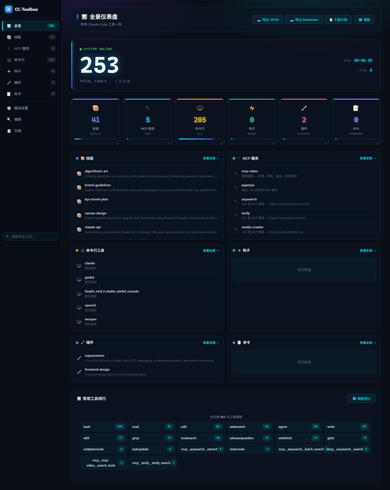
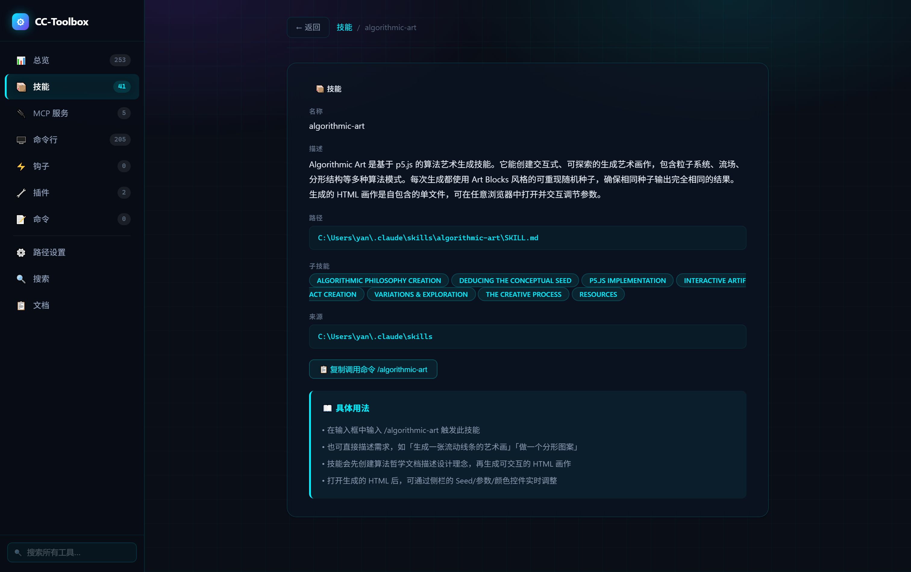
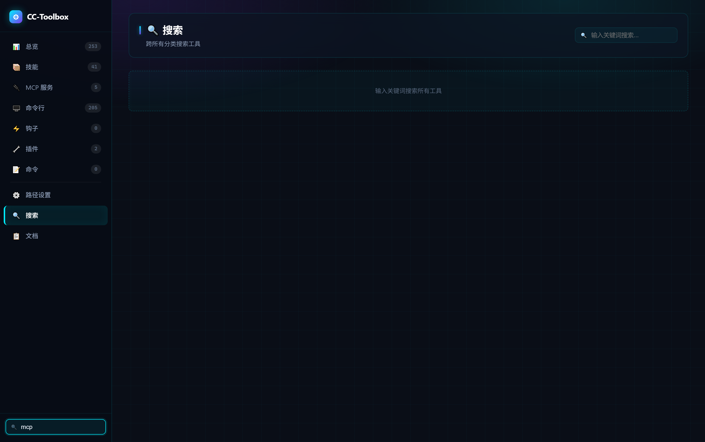

# 🧰 CC-Toolbox — A Visual Control Panel for Your Claude Code Toolbox

> **Put all your scattered Claude Code tools into one deep-space dashboard.**
> A local web panel that inventories, explains, and manages every **Skill / MCP / CLI / Hook / Plugin / Command** you have installed — what you've got, what it does, how to use it, all on one screen. Plus **one-click AI deployment**: hand the repo to your AI agent and it installs everything for you.

`Claude Code` · `MCP manager` · `Skill explorer` · `Local dashboard` · `AI one-click deploy` · `Deep-space UI`

**English** | [简体中文](README.md)



---

## ✨ Why it's worth using

| Pain point | What CC-Toolbox does |
|---|---|
| Tools scattered across `~/.claude/`, PATH, and various config files — you can't remember what's installed | **One dashboard for everything**: auto-scans 6 tool categories, with totals, per-category counts, and a usage leaderboard |
| A pile of MCP / Skill names with no idea what they do or how to call them | **Descriptions & usage in plain language**: built-in knowledge base, plus **AI-filled descriptions** (highest priority) per tool |
| Want to verify an MCP connection or temporarily disable a Hook — edit config files by hand | **One-click actions**: MCP connection test (JSON-RPC handshake), Hook enable/disable (auto-backup + atomic write + rollback on failure) |
| Want to share your environment setup with a friend / your AI | **One-click export** to JSON / Markdown |
| Painful to deploy; re-configuring on a new machine | **Truly portable**: zero hardcoded paths; **7-step AI-agent auto-deploy**; double-click the desktop icon and it runs |

**More details**: deep-space dashboard UI (glassmorphism cards + rolling number animations + responsive), auto port probing (can run alongside a legacy service on 8765), 107 automated tests, CSRF protection, graceful degradation on broken config files, fully local — zero data upload.

---

## 🎯 What it can do

- 📊 **Full-coverage dashboard**: total tools (animated counter) + 6 category cards with share bars + category previews + a usage leaderboard (counted from real session logs)
- 📦 **6 tool categories**: Skills / MCP servers / CLI tools / Hooks / Plugins / Commands — lists, filters, details, global search
- ⚡ **Quick actions**: test MCP connections, toggle Hooks safely, view CLI `--help`, copy invocation commands
- 🗂 **Path settings page**: visually manage custom scan directories + extra MCP project directories, open them in your file explorer
- 🤖 **AI tool descriptions**: have AI write 1–3 sentence summaries per tool from an `example` template; saved and effective immediately
- 📤 **Config export**: one-click JSON / Markdown export of your whole tool inventory
- 🔒 **Safety & robustness**: CSRF checks on POST endpoints, security headers, Hook write backup/rollback, malformed configs filtered out automatically



---

## 🚀 Quick start

### Option 1: Desktop icon (recommended, Windows)

1. Double-click **`一键安装并创建桌面图标.bat`** — creates a Python venv, installs dependencies (Chinese mirror first, falls back to PyPI), and places a **CC-Toolbox** icon on your desktop
2. From then on, double-click the icon — silent launch with no console window (shows a wait window), opens your browser automatically; **click again = stop**

### Option 2: Command line

```bash
python -m venv venv
# Windows: venv\Scripts\activate    macOS/Linux: source venv/bin/activate
pip install -r requirements.txt
python app.py
```

The startup log and `server_addr.txt` give you the actual URL (auto-probes from **port 8765**, so it can coexist with a service hard-coded to 8765).

### Option 3: 🤖 Hand it to your AI agent for one-click deployment

Give this repo to Claude Code (or any AI agent) and say "deploy per the README":

```text
1. Copy/clone this project to any directory on the target machine (Chinese paths are fine)
2. Ensure python >= 3.9 exists; run python -m venv venv in the project directory
3. Install requirements.txt with the venv's pip (Tsinghua mirror preferred, default source on failure)
4. Optional: write the user's skill/CLI install dirs into config/paths_config.json;
   optional: fill config/ai_descriptions.json following config/ai_descriptions.example.json
5. Start python app.py; wait for server_addr.txt (<=20s), read the URL and verify GET /api/summary returns 200
6. Optional: python -m pytest tests/ -q (all 107 tests should pass)
7. Report the access URL plus configured paths/descriptions count to the user
```

---

## 🧠 Main runtime flow (mental model)

```
Double-click desktop icon (or launcher.bat)
   ↓
launch_w.pyw (windowless launcher)
   ├─ Shows a wait window (spinner + elapsed seconds)
   ├─ Starts venv\Scripts\python.exe app.py in the background
   ├─ Polls server_addr.txt (written once the server knows its URL)
   └─ Ready → close window → open browser → show URL dialog
   ↓
Flask service: probe free port → scan ~/.claude/ and custom dirs → serve /api/*
   ↓
Browser dashboard: page JS renders from /api/* (120s cache; "Refresh" forces a rescan)
```

**First launch takes ~10–20 seconds** (full scan of tool directories) — the wait window makes it visible; subsequent launches are noticeably faster.

### Startup components

| Component | Purpose |
|---|---|
| Desktop icon → `launch_w.pyw` | Daily main entry: no console window, wait window, double-click toggles start/stop |
| `launcher.bat` | Troubleshooting fallback: shows every step's output; auto-installs deps on first run, then starts **offline** |
| `venv/` | Project-local isolated Python environment (full interpreter copy + deps — large size is normal); deletable, auto-rebuilt |

---

## ⚙️ Config files (all in `config/`, auto-fallback if corrupted)

### `config/paths_config.json` — custom scan paths

```json
{
  "skill_paths": ["D:\\my\\skills"],
  "cli_paths": ["D:\\my\\cli"],
  "extra_mcp_project_dirs": ["E:\\some-project"]
}
```

Also manageable visually on the web **Settings** page.

### `config/ai_descriptions.json` — AI tool descriptions (highest priority)

Format documented in `config/ai_descriptions.example.json`: grouped by type, each tool gets `{desc: "1-3 sentence summary", usage: "optional usage"}`. Saved = effective. "Update descriptions" on the docs page merges into the cache; **deleting an entry falls back automatically**.

### Ports & running side-by-side

- Env vars `CC_TOOLBOX_HOST` / `CC_TOOLBOX_PORT` (0 = auto-probe); CLI `python app.py --port 9000`
- Coexist with a fixed-8765 service: start the old one first, this panel drops to 8766+

---

## 🧪 Quality

```bash
python -m pytest tests/ -q   # 107 tests
```

Covers: scanners & malformed-data defense (24), CSRF security (15), Hooks (15), windowless launcher (9), description cache (9), API & search (9), path config (8), AI descriptions (8), export (4), startup (3), isolation & smoke (2).

Tests run green on a **clean machine with no real `~/.claude/`** — the suite is fully isolated. CI runs them on every push (Windows, Python 3.11 & 3.13).

Manual test checklist: [`docs/测试文档.md`](docs/测试文档.md) (38 checkable cases incl. old-vs-new comparison).



---

## 📁 Project structure

```
CC-Toolbox/
├── 一键安装并创建桌面图标.bat   # First-run installer (start here)
├── launcher.bat / launch_w.pyw # Launchers (console / windowless)
├── app.py / config.py / paths_config.py / desc_cache.py   # Core
├── scanners/    # 6 tool scanners + usage stats
├── templates/ + static/        # Deep-space dashboard frontend
├── config/      # ★ User data (paths / AI descriptions / desc cache)
├── docs/        # Test docs / icon assets / screenshots
└── tests/       # pytest suite (107)
```

---

## ❓ FAQ

- **Does launcher.bat download anything?** Only on first run (or if `venv` was deleted); after that it starts offline
- **Why is venv so big?** A full Python copy + deps — tens to ~100+ MB is normal; deletable and rebuildable
- **Descriptions inaccurate?** Have AI fill `config/ai_descriptions.json`; saved = effective
- **Desktop icon not refreshing?** F5 on the desktop; if still stale, restart explorer (see docs/测试文档.md)
- **Is my data safe?** Fully local, nothing is sent anywhere; Hook writes back up `settings.json.cc-toolbox.bak` first

---

## 🗺 Roadmap

- [ ] Usage trend charts (time series)
- [ ] Live file-watching auto refresh
- [ ] One-click tool install / uninstall
- [ ] English UI

Issues and PRs welcome — see [CONTRIBUTING.md](CONTRIBUTING.md).

## 📄 License

[MIT](LICENSE) © youxicat-QAQ — use it, modify it, even ship it commercially; just keep the copyright notice.

---

<p align="center">
  <b>Star this project ⭐ if it helps you make sense of your Claude Code toolbox</b><br>
  <sub>Local · Open source · Portable · Built for heavy Claude Code users</sub>
</p>
